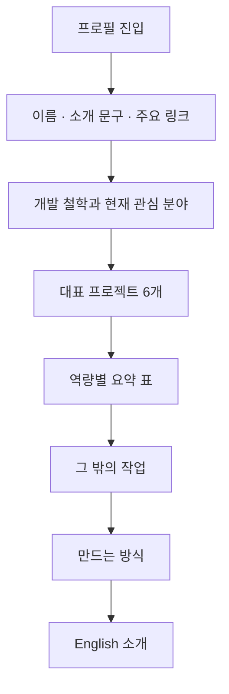
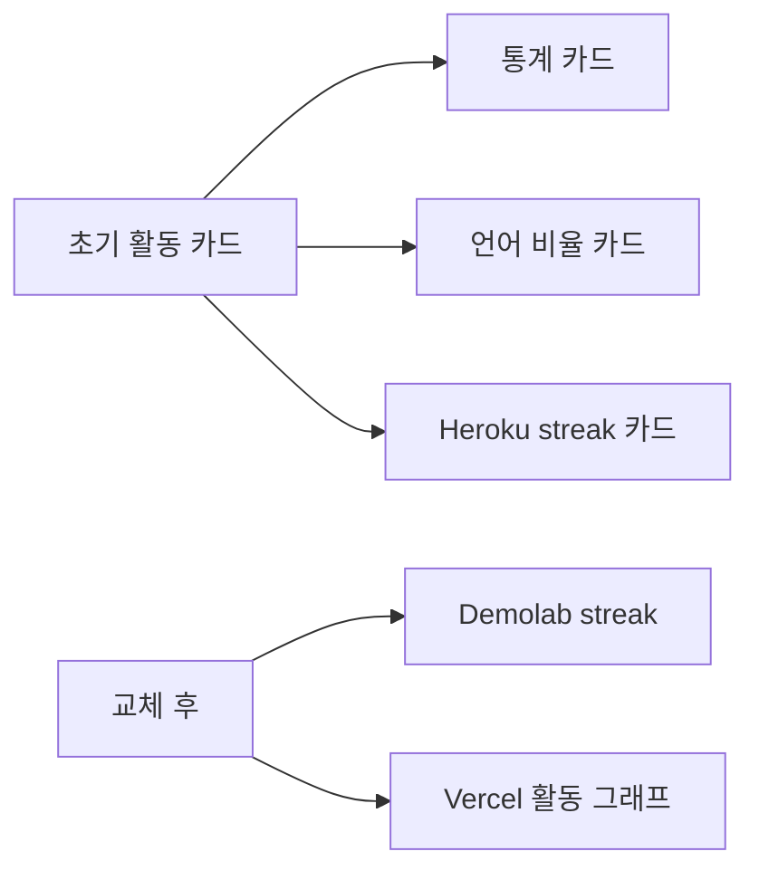

# 2026-11-25 | 프로필의 탄생과 정보 설계

> 하나의 README를 개인 기술 포트폴리오의 입구로 만드는 과정.

- 기록 방식: 2026-11-28에 작성한 소급 개발기
- 대상: `hslcrb/hslcrb`
- 근거: 아래 다섯 커밋의 실제 패치
- 날짜 및 시각: KST(UTC+9)
- 범위: 프로필 저장소 자체의 변경. 소개된 개별 프로젝트의 기능을 다시 시험한 기록은 아니다.

## 1. 출발점

2026년 11월 25일 08:10:48, 최초의 프로필 README가 커밋되었다. 이 저장소는 일반적인 애플리케이션 저장소와 달리 계정 이름과 저장소 이름이 일치하는 GitHub 프로필 저장소다. 따라서 루트 README는 단순히 저장소의 설명서가 아니라 개발자의 공개 프로필을 구성하는 콘텐츠다.

초기 목표는 파일 변경 이력에서 읽을 수 있는 범위에서 정리하면 세 가지다. 첫째, 개발자가 무엇을 만드는지 첫 화면에서 이해할 수 있게 한다. 둘째, 프로젝트 설명을 실제 소스 및 실행 링크와 연결한다. 셋째, 구현 가능 범위와 검증의 중요성을 명확히 표현한다. 이는 커밋으로 확인된 설계 방향에 대한 해석이며 당시 작성자의 별도 기획 문서를 확인한 것은 아니다.

## 2. 변경 연표

| KST | 커밋 | 확인된 변경 |
| --- | --- | --- |
| 08:10:48 | [fbe7087](https://github.com/hslcrb/hslcrb/commit/fbe7087e7ad90d5805303f5e79c2c941198fa1bb) | 최초 README 100줄 추가 |
| 10:00:45 | [4c05439](https://github.com/hslcrb/hslcrb/commit/4c05439bdd7dc86f0c7e02d792988b7b10895567) | 배지, 기술 스택, 활동 카드 추가 및 공개 프로젝트 목록 정리 |
| 10:05:21 | [a23bbe3](https://github.com/hslcrb/hslcrb/commit/a23bbe34ba17b94145d9c1865973610b028f5722) | 통계 및 언어 비율 카드 제거, streak 및 활동 그래프 조합으로 교체 |
| 10:38:27 | [84d8783](https://github.com/hslcrb/hslcrb/commit/84d878380d91459f1eb84c8453d8890a413738c4) | 대표 문구를 '가능성을 구현하는 Creator'로 변경 |
| 23:08:51 | [0f4e81d](https://github.com/hslcrb/hslcrb/commit/0f4e81d60f4cec4f995fd3db1fe0684fb48bf853) | NO_WAR, YES_PEACE, ONLY_LOVE 메시지 추가 |

## 3. 최초 프로필의 구조

개별 프로젝트를 단순 나열하지 않고 각 프로젝트마다 구현 기술과 확인 가능한 경로를 붙였다. 실행 링크가 있는 프로젝트는 실행 링크를, 개발기와 설계 문서가 있는 프로젝트는 문서 링크를 제공했다. 브라우저 중심 도구, 아카이빙, 3D, 교육 데이터, 로컬 우선 작업이라는 여러 분야를 한 화면에서 탐색할 수 있도록 구성했다.

| 대표 프로젝트 | 프로필에서 전달하는 핵심 | 기술적 관심사 |
| --- | --- | --- |
| PlayTheClipse | 브라우저 Java/JSP 워크벤치 | JVM, 컴파일러, 웹 런타임 |
| Wayglass | 웹 아카이빙과 재생 | Rust, WARC/WACZ, CLI |
| 도시 캐릭터 | 지자체 마스코트 3D 뷰어 | Blender, GLB, Three.js |
| 폰트 스위쳐 | 로컬 폰트 형식 변환 | TypeScript, 폰트 윤곽 |
| JSONote | JSON 기반 노트와 동기화 | Next.js, GitHub API, MCP |
| HANBOM DATA | 교육 데이터 인터페이스 | REST, MCP, 공개 데이터 |

위 표는 최초 및 현재 README에 적힌 소개를 요약한 것이다. 별도 프로젝트의 실제 코드 검증 결과로 해석해서는 안 된다.

## 4. 시각적 정보 밀도 개선

두 번째 커밋에서 상단의 팔로워·시작 시기·브랜드 배지와 기술 스택의 네 분류(언어, 프론트엔드, 백엔드와 데이터, 인프라와 도구)가 추가되었다. 링크와 텍스트가 많아지는 환경에서 배지는 빠르게 훑어볼 수 있는 작은 시각적 인덱스로 기능한다. 기술명 배지는 숙련도 측정 결과가 아니라 기술 범위의 표시다.

또한 공개 소개 대상 프로젝트를 정리했다. 당시 변경에서 빠진 항목은 현재 공개 프로필에 재노출하지 않는다. 삭제 이유나 비공개 전환 여부는 별도로 확인하지 않았으므로 단정하지 않는다.

## 5. 활동 시각화의 첫 번째 시행착오

10:00 커밋에서는 GitHub Readme Stats의 통계 및 언어 비율 카드와 Heroku 주소의 Streak Stats 카드가 추가되었다. 약 5분 후 다시 커밋하여 통계 및 언어 비율 카드를 제거하고, Streak Stats를 demolab.com 주소로 전환했으며 Vercel의 Activity Graph를 추가했다.

커밋 제목은 안정적인 카드로 교체한다고 되어 있다. 다만 당시 HTTP 응답이나 실제 실패 화면을 보존한 기록은 확인하지 못했으므로, 각 서비스에서 정확히 어떤 장애가 발생했는지는 기록하지 않는다. 외부 그래프 서비스에 의존하는 구조 자체는 남아 있었고, 이것은 11월 28일의 장애 대응으로 이어지는 중요한 배경이 되었다.

## 6. 라이트·다크 모드

활동 카드에 HTML picture 요소를 사용하고, prefers-color-scheme 조건에 따라 dark source와 기본 img를 분리했다. 이는 GitHub 테마가 달라졌을 때 텍스트와 선이 배경에서 구분되도록 하는 설계다. 실제 테마 선택 및 이미지 표시 결과는 브라우저와 GitHub의 렌더링 정책에 의존한다.

## 7. 대표 문구와 공개 가치

초기 문구는 설치 없는 브라우저 도구라는 구체적인 구현 목표에 초점을 맞췄다. 이후 '가능성을 구현하는 Creator'로 바뀌었다. 여러 기술 분야를 포괄하는 표현으로 확장된 셈이다. 같은 날 마지막 커밋에서 #NO_WAR, #YES_PEACE, #ONLY_LOVE가 추가되었다. 프로필의 기술적 내용과 별도로 공개적인 가치 표현이 문서의 끝에 위치한다.

## 8. 회고와 남은 일

이 시점까지의 작업은 컴파일이나 서버 배포가 필요한 애플리케이션 개발이 아니라 Markdown, HTML 요소, 외부 이미지 제공자, 공개 링크를 조합하는 정보 설계에 가깝다. README 자체는 단순하지만 외부 링크와 이미지의 수명은 각 서비스에 달려 있다. 이후에는 그래프 주소가 바뀌거나 링크가 끊기는 상황을 소스 변경과 구분해서 점검해야 한다.

- 확인: 다섯 커밋의 제목과 실제 README 변경.
- 미확인: 당시 스크린샷, 접근성 및 브라우저별 표시 결과, 개별 프로젝트 실행 상태.
- 다음 기록: [2026-11-28 활동 그래프 장애 대응](2026-11-28-activity-graph-migration.md).
