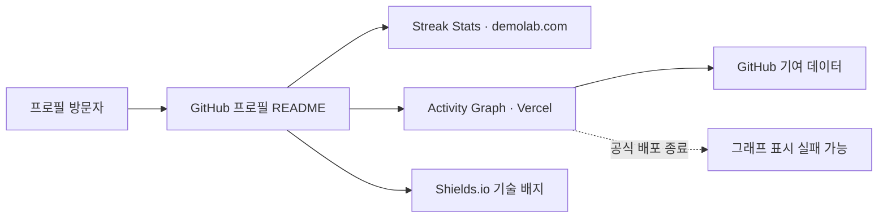
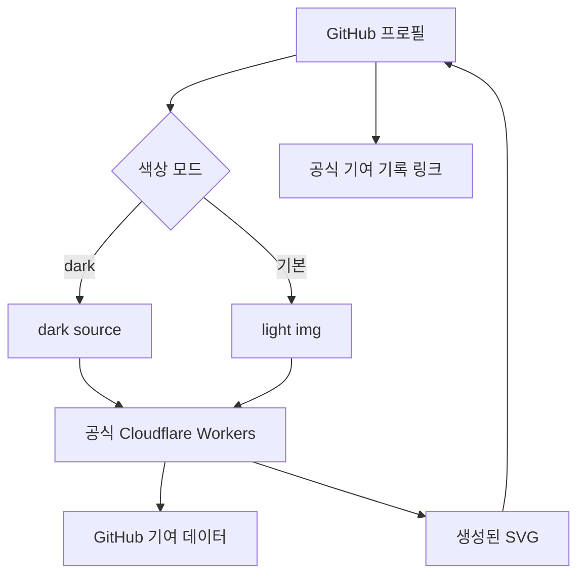
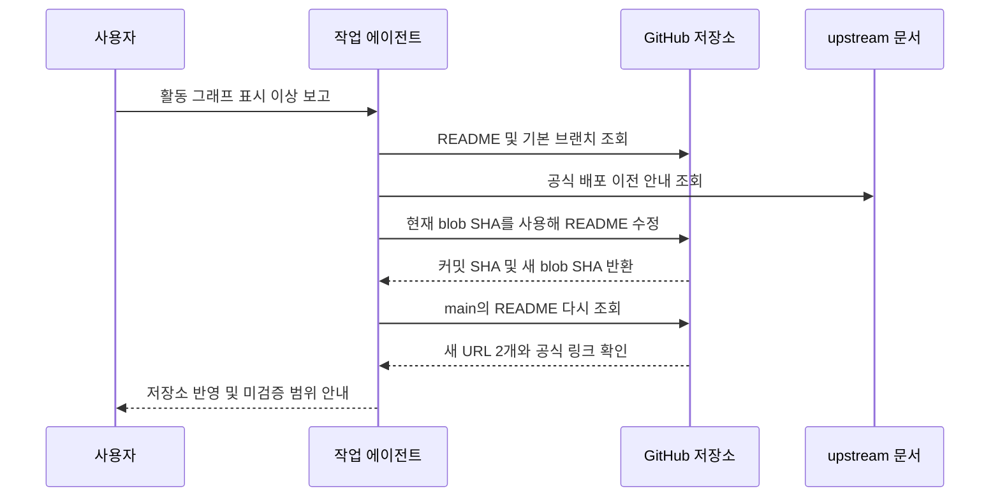

# 2026-11-28 | 사라진 활동 그래프와 Cloudflare Workers 이전

> 프로필은 그대로였지만, 그래프를 그려 주던 서버의 주소가 바뀌었다.

- 대상 저장소: `hslcrb/hslcrb`
- 작업 시각: 2026-11-28 00:28:58 KST (수정 커밋 기준)
- 유형: 외부 서비스 의존성 장애 대응
- 수정 커밋: [b8af013](https://github.com/hslcrb/hslcrb/commit/b8af013397d27244b49eaca03b471bc4c7c10b99)
- 변경 파일: 루트 `README.md`
- 상태: 수정 및 main 반영 확인 / 외부 SVG 실렌더링은 미검증

## 1. 발단

사용자로부터 프로필의 GitHub 활동 그래프가 나타나지 않는다는 보고가 들어왔다. 활동 그래프는 일별 GitHub 기여를 선과 면적으로 보여 주는 외부 생성 이미지이며, GitHub 자체의 기여 잔디와는 별개의 표시 요소다.

이상 징후를 해결하기 위해 README의 활동 영역을 먼저 조사했다. 사용자 이름, 저장소 이름, 이미지의 URL, 라이트 모드와 다크 모드의 구성, 외부 서비스의 공식 문서를 차례로 확인하는 방식으로 진행했다.

## 2. 장애 이전 구조



이 저장소에는 자체 그래프 계산 프로그램이나 이미지 생성 서버가 없다. README가 외부 이미지 URL을 참조하고 제공 서비스가 SVG를 만들어 반환하는 구조다. 따라서 README가 정상이라도 이미지 서비스가 사라지면 그래프 영역만 표시되지 않을 수 있다. GitHub 이미지 프록시 및 캐싱은 이 과정에 관여할 수 있지만, 이번에는 그 동작을 직접 관측하지 않았다.

## 3. 원인 조사

### 3.1 저장소 상태

GitHub API를 통해 저장소의 기본 브랜치가 main이며 공개 저장소라는 점, 루트에 README.md가 존재하는 점을 확인했다. 수정 전 README의 blob SHA는 다음과 같았다.

```text
d70ceab1f3baa825aff08721943cfb1e55f11ab9
```

활동 그래프의 dark source와 기본 img 양쪽에 동일한 Vercel 도메인이 적혀 있었다. 연속 활동 카드는 별도의 Demolab 주소를 참조하고 있었다. 즉 활동 그래프 문제를 고치기 위해 두 카드 모두를 바꿀 필요는 없었다.

### 3.2 upstream 확인

[github-readme-activity-graph 공식 README](https://github.com/Ashutosh00710/github-readme-activity-graph)의 이전 안내를 직접 읽었다. 기존 Vercel 엔드포인트는 더 이상 그래프를 제공하지 않는다고 명시되어 있고, Cloudflare Workers 주소를 사용하도록 안내하고 있었다. 기존 URL의 도메인만 바꾸고 나머지 쿼리를 유지하는 것이 upstream 권장 방법이다.

따라서 확인 가능한 근본 원인은 폐기된 호스팅 주소를 계속 사용하고 있었다는 점이다. 사용자의 화면에서 나타난 현상에 부합한다. 다만 당시 HTTP 상태 코드, 응답 헤더, GitHub Camo 캐시의 상태는 측정하지 않았으므로 특정 응답 코드나 타임아웃을 장애의 증거로 단정하지 않는다.

## 4. 해결 방향의 비교

| 대안 | 장점 | 비용 및 한계 | 결정 |
| --- | --- | --- | --- |
| 기존 URL 유지 | 수정 없음 | upstream에서 종료한 주소 | 제외 |
| 공식 Cloudflare 주소로 이전 | 변경량 최소, 기존 스타일 보존 | 공유 서버의 가용성 및 API 제한 | 채택 |
| 직접 Workers 운영 | 캐시, 설정, 관측 제어 가능 | 배포, 인증, 운영 및 보안 관리 필요 | 향후 검토 |
| 정적 SVG를 저장소에 보관 | 외부 표시 의존성 감소 | 갱신 방식 필요, 오래된 데이터 가능 | 향후 검토 |
| 공식 기여 기록으로 연결 | 그래프 장애 시 탐색 경로 제공 | README 내부 시각화의 대체는 아님 | 보조 경로로 채택 |

당장 필요한 것은 장애가 난 그래프 참조의 수정이지 별도의 운영 인프라 구축이 아니다. 따라서 사용자에게 요구되지 않은 배포나 비밀키 생성, GitHub Actions 도입 없이 최소 변경을 수행했다.

## 5. 실제 변경

```diff
- https://github-readme-activity-graph.vercel.app/graph
+ https://github-readme-activity-graph.ashutosh-dwivedi0710.workers.dev/graph
```

두 테마의 URL을 모두 교체했다. 실제 커밋에서는 기존 주소의 두 출현 위치를 교체하고, 그래프 설명과 공식 기록 링크를 수정했다.

| 속성 | 라이트 모드 | 다크 모드 |
| --- | --- | --- |
| username | hslcrb | hslcrb |
| bg_color | 00000000 | 00000000 |
| color | 57606a | 8b949e |
| line | 0969da | 58a6ff |
| point | 1f2328 | ffffff |
| area | true | true |
| area_color | 54aeff | 1f6feb |
| hide_border | true | true |

표의 모든 파라미터는 기존 값 그대로 유지되었다. HTML 속성에 쓰인 구분자 `&amp;` 역시 보존했다. 테마 조건, 이미지 구조와 기존 Streak Stats 카드도 손대지 않았다.

### 5.1 대체 텍스트의 정확성

기존 alt 속성에는 최근 1년의 일별 기여 그래프라고 쓰여 있었다. upstream 문서에 명시된 기본 표시 기간은 31일이고 README에서 days를 별도로 지정하지 않으므로, '최근 31일의 일별 기여 그래프'로 수정했다. 이 변경은 표시 기간을 새롭게 지정한 것이 아니라 기존 설명을 기본 동작에 맞춘 것이다.

### 5.2 보조 탐색 경로

[GitHub 공식 기여 기록](https://github.com/hslcrb#contributions)으로 이동하는 링크를 추가했다. 외부 그래프가 다시 장애를 일으켜도 독자는 GitHub 프로필의 공식 기여 기록으로 직접 이동할 수 있다. 이는 자동 이미지 페일오버가 아닌 명시적인 수동 대체 경로다.

## 6. 수정 이후의 데이터 흐름



위 도식은 설계상 요청 흐름이며, 실제 Worker에서 GitHub 데이터 요청 및 SVG 반환까지 성공했다는 측정 기록은 아니다.

## 7. 변경 적용 과정



업데이트는 GitHub Contents API를 사용하는 연결 도구로 수행했다. 수정 전 blob SHA를 전달해 기존 파일의 상태를 기준으로 변경했고, 기본 브랜치에서 재조회하여 결과를 확인했다. 실제 로컬 git 명령 실행이나 GitHub Actions 실행은 없었다.

- 수정 커밋: `b8af013397d27244b49eaca03b471bc4c7c10b99`
- 수정 후 README blob: `95f1e0075129251996db699db9b83cf0f82bfd94`
- 변경 유형: README 내 3줄 교체 (두 이미지 참조와 안내 문장)
- 브랜치: main

## 8. 검증 결과

| 항목 | 결과 | 근거 |
| --- | --- | --- |
| upstream 이전 공지 | 확인 | 공식 README |
| main 반영 | 통과 | 수정 후 README 재조회 |
| 기존 Vercel 그래프 주소 제거 | 통과 | 재조회한 전체 README 문자열 검사 |
| 새 주소 라이트/다크 각각 반영 | 통과 | 활동 영역 재조회 |
| 스타일 파라미터 및 streak 카드 유지 | 통과 | 커밋 패치 비교 |
| 31일 대체 텍스트 | 통과 | 수정된 img 속성 |
| 공식 기여 기록 링크 | 통과 | README 재조회 |
| 새 Worker HTTP 응답 및 SVG 유효성 | 미검증 | 네트워크 응답 미측정 |
| GitHub 프로필 실화면 및 양쪽 테마 | 미검증 | 브라우저 실렌더링 미관측 |
| 그래프의 실제 기여 수 일치 | 미검증 | 공식 기록과 수치 대조 미실시 |

이번 작업의 완료 범위는 공식 주소로의 전환과 저장소 반영까지다. 공유 인스턴스가 GitHub API의 요청 제한이나 자체 장애를 겪을 가능성은 남아 있다. 실화면 복구 확인은 별도의 검증 항목으로 유지한다.

## 9. 재현 및 점검 명령

다음 명령은 이후 유지보수 담당자가 로컬에서 사용할 수 있는 예시이며 이번 작업에서 실행한 명령은 아니다.

```bash
git clone https://github.com/hslcrb/hslcrb.git
cd hslcrb
git log --oneline -n 10
git show b8af013 -- README.md
git grep -n 'github-readme-activity-graph' -- README.md
```

```bash
URL='https://github-readme-activity-graph.ashutosh-dwivedi0710.workers.dev/graph?username=hslcrb'
curl -fL --max-time 30 -D headers.txt -o activity.svg "$URL"
head -c 300 activity.svg
```

HTTP 성공 코드만으로 그래프 성공을 단정하지 않는다. 응답 Content-Type, 실제 SVG 루트 및 오류 안내 이미지 여부를 확인하고 프로필 페이지에서 라이트·다크 모드 표시를 모두 점검한다. 로컬 점검 파일은 저장소에 커밋할 필요가 없다.

## 10. 재발 방지와 운영 판단

외부 서비스의 주소와 운영 주체는 변할 수 있다. 같은 장애가 재발할 경우 아래 순서로 조사한다.

1. 공식 GitHub 기여 기록이 표시되는지 확인하여 원본 데이터와 별도 이미지 문제를 구분한다.
2. README의 이미지 경로와 두 테마의 파라미터를 확인한다.
3. upstream 공식 공지와 배포 주소를 비교한다.
4. 새 주소의 실제 응답과 SVG 내용을 확인한다.
5. GitHub의 이미지 캐시 및 브라우저 표시를 별도로 확인한다.
6. 장애가 반복될 때만 자체 Workers 운영이나 정적 SVG 갱신 방식을 검토한다.

자체 서비스 운영이 필요해지면 인증 정보는 공개 README 및 이미지 URL에 포함하지 않는다. 배포 전에 갱신 주기, 데이터 출처, API 제한, 캐시 및 오류 시 표시 방식을 명시한다. 이러한 대안들은 아직 구현되지 않았다.

## 11. 결론

기여 기록 자체와 그것을 보여 주는 그래프는 다른 시스템이다. 외부 이미지 한 장에도 호스팅 수명, API 제한, 테마, 프록시와 캐시라는 의존성이 존재한다. 이번 변경은 그 의존성을 확인하고 기존 시각적 구성을 유지하면서 공식 배포 경로로 옮긴 작은 마이그레이션이다.

후속 검증에서 실제 화면이 정상임이 확인되면 그 결과와 확인 시각을 별도 기록에 추가한다. 추측을 검증 결과로 포장하지 않는다.

## 참고

- [수정 커밋 및 diff](https://github.com/hslcrb/hslcrb/commit/b8af013397d27244b49eaca03b471bc4c7c10b99)
- [upstream README 및 배포 이전 안내](https://github.com/Ashutosh00710/github-readme-activity-graph)
- [GitHub 프로필](https://github.com/hslcrb)
- [이전 개발기](2026-11-25-profile-foundation.md)
